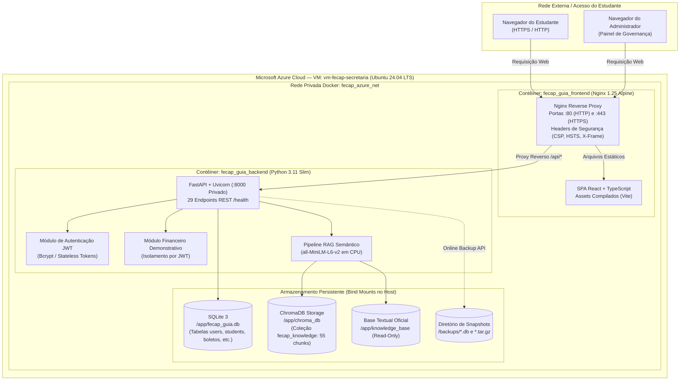

# RELATÓRIO TÉCNICO DE INFRAESTRUTURA, COMPUTAÇÃO EM NUVEM E CONTAINERS
## Projeto SecretarIA — Agente para o Estudante (FECAP)
### Disciplina: Sistemas Operacionais e Computação em Nuvem — Entrega 2

---

## 1. Visão Geral da Arquitetura

A SecretarIA foi projetada seguindo uma arquitetura de microsserviços desacoplada, empacotada em contêineres Docker e implantada em uma Máquina Virtual na nuvem da Microsoft Azure (Região Brazil South), com paridade operacional para desenvolvimento local.

A solução é composta por:
1. **Camada de Borda / Entrada (Gateway & Frontend)**: Servidor Web Nginx atuando como Proxy Reverso e servidor de arquivos estáticos da Single Page Application (SPA) em React/TypeScript.
2. **Camada de Aplicação e Negócio (Backend API)**: FastAPI (Python 3.11) executando de forma assíncrona com Uvicorn.
3. **Camada de Inteligência e Recuperação (RAG)**: ChromaDB (banco vetorial persistente) com modelo de embeddings semânticos local `all-MiniLM-L6-v2`.
4. **Camada de Persistência Relacional**: SQLite 3 operando com SQLAlchemy Async em modo Write-Ahead Logging (WAL) para integridade transacional.
5. **Camada de Observabilidade e Auditoria**: Logs estruturados em formato JSON com `structlog` e rastreamento de ações via tabela `audit_logs` (conformidade LGPD).

---

## 2. Diagrama da Arquitetura de Implantação



---

## 3. Especificação dos Componentes da Infraestrutura

### 3.1 Máquina Virtual na Azure (`vm-fecap-secretaria`)
- **Provedor de Nuvem**: Microsoft Azure.
- **Região**: Brazil South (São Paulo).
- **Sistema Operacional**: Ubuntu 24.04 LTS (Noble Numbat).
- **Gerenciador de Contêineres**: Docker Engine 27.x com plugin Docker Compose v2.
- **Topologia de Segurança e Firewall (NSG)**:
  - Portas 80 e 443 liberadas para entrada web pública via Nginx.
  - Porta 22 protegida para administração remota via chave SSH.
  - Portas 8000 (API FastAPI) e 5173 **bloqueadas externamente**, acessíveis exclusivamente via rede interna Docker.

### 3.2 Contêiner Frontend (`fecap_guia_frontend`)
- **Imagem Base**: `nginx:1.25-alpine`.
- **Função**: Gateway de borda, terminação HTTP/HTTPS, compressão Gzip e roteamento de tráfego.
- **Configuração de Proxy Reverso**:
  ```nginx
  location /api/ {
      proxy_pass http://backend:8000/api/;
      proxy_http_version 1.1;
      proxy_set_header Host $host;
      proxy_set_header X-Real-IP $remote_addr;
      proxy_set_header X-Forwarded-For $proxy_add_x_forwarded_for;
      proxy_set_header X-Forwarded-Proto $scheme;
  }
  ```
- **Healthcheck**: `wget -q -O /dev/null http://127.0.0.1:5173/ || exit 1` a cada 15 segundos.

### 3.3 Contêiner Backend (`fecap_guia_backend`)
- **Imagem Base**: `python:3.11-slim`.
- **Servidor ASGI**: `uvicorn app.main:app --host 0.0.0.0 --port 8000`.
- **Framework Web**: FastAPI com validação de contratos estritos via Pydantic v2.
- **Healthcheck**: `curl -f http://localhost:8000/health` (start period: 30s, intervalo: 15s).

---

## 4. Persistência de Dados e Volumes

A persistência de dados foi arquitetada para **evitar qualquer perda de dados acidental** durante ciclos de deploy, recriação de contêineres ou reinicialização da máquina virtual:

| Caminho no Host | Caminho no Contêiner | Modo | Finalidade |
|---|---|---|---|
| `./backend/fecap_guia.db` | `/app/fecap_guia.db` | `rw` | Banco relacional SQLite contendo usuários, sessões e boletos |
| `./backend/chroma_db` | `/app/chroma_db` | `rw` | Diretório de índices vetoriais do ChromaDB |
| `./knowledge_base` | `/app/knowledge_base` | `ro` | Base normativa oficial em arquivos `.txt` (proteção contra escrita indevida) |
| `./backups` | `/backups` | `rw` | Destino de backups transacionais gerados pelo contêiner |

---

## 5. Paridade entre Ambientes (Local vs. Nuvem Azure)

| Parâmetro | Ambiente Local de Desenvolvimento | Ambiente de Nuvem (Azure VM) |
|---|---|---|
| **Ponto de Acesso Web** | `http://localhost:5173` | `http://localhost:8080` (túnel SSH) / IP Público Azure |
| **Ponto de Acesso API** | `http://localhost:8000` (ou `/api` via Nginx) | `/api/` roteado internamente via Nginx |
| **Isolamento de Rede** | Bridge Docker `fecap_guia_network` | Bridge Docker privada `fecap_azure_net` |
| **Variáveis de Ambiente** | `backend/.env` | `.env.azure` injetado pelo Docker Compose |
| **Modo da Aplicação** | `APP_ENV=development` | `APP_ENV=production` |
| **Logs Estruturados** | Console estruturado / JSON | Formato JSON estrito via `structlog` |
