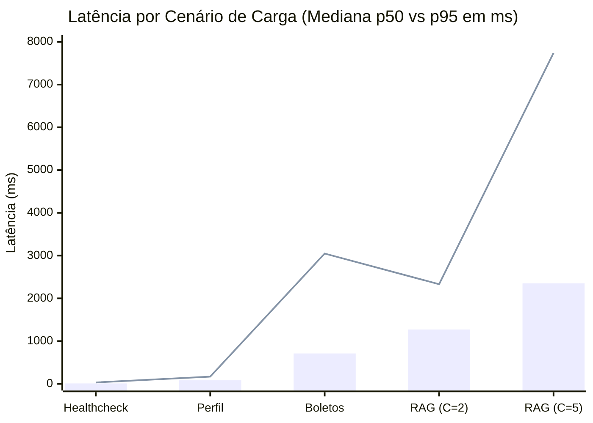

# RELATÓRIO TÉCNICO DE TESTES DE CARGA, DESEMPENHO E ANÁLISE DE GARGALOS
## Projeto SecretarIA — Agente para o Estudante (FECAP)
### Disciplina: Sistemas Operacionais e Computação em Nuvem — Entrega 2

---

## 1. Metodologia do Teste de Carga

Para avaliar o comportamento da solução sob concorrência e respeitar os limites operacionais da Máquina Virtual, foi desenvolvido um script de teste assíncrono em Python utilizando as bibliotecas `asyncio` e `httpx` ([run_load_test.py](file:///C:/SecretaRIA/fecap-guia/backend/run_load_test.py)).

### Características do Teste:
- **Ponto de Entrada**: Porta `5173` do Proxy Reverso Nginx (simulando a rota real de navegação do usuário).
- **Total de Requisições Disparadas**: **150 requisições**.
- **Autenticação**: Sessão autenticada real via token JWT de estudante (`ana.silva@fecap.br`).
- **Isolamento e Segurança**: Foram testadas apenas consultas e leituras (operações idempotentes), sem execução de pagamentos, alterações de banco ou gravação de dados destrutivos.
- **Métricas Coletadas**: Throughput (requisições por segundo), tempo total, latência média, mediana (p50), 95º percentil (p95), 99º percentil (p99) e taxa de erro.

---

## 2. Resultados Detalhados por Cenário de Carga

Os testes foram divididos em 5 baterias progressivas, partindo de requisições web simples até inferência semântica complexa:

| Bateria / Cenário | Concorrência (C) | Requisições (N) | Tempo Total (s) | Throughput (req/s) | Latência Média (ms) | Mediana p50 (ms) | Latência p95 (ms) | Taxa de Erro | Status HTTP |
|---|---|---|---|---|---|---|---|---|---|
| **1. Healthcheck / Liveness** (`/health`) | **5** | 50 | 0.157 s | **317.84** | **14.54 ms** | **10.55 ms** | **32.77 ms** | **0.0%** | 50 x 200 OK |
| **2. Perfil do Estudante** (`/student/profile`) | **5** | 40 | 0.756 s | **52.90** | **91.52 ms** | **83.32 ms** | **169.20 ms** | **0.0%** | 40 x 200 OK |
| **3. Boletos Pendentes** (`/boletos/pending`) | **5** | 30 | 6.730 s | **4.46** | **1.052,37 ms** | **711.38 ms** | **3.048,37 ms** | **0.0%** | 30 x 200 OK |
| **4. RAG Acadêmico (Baixa Carga)** (`/agent/query`) | **2** | 10 | 7.188 s | **1.39** | **1.357,01 ms** | **1.270,83 ms** | **2.330,79 ms** | **0.0%** | 10 x 200 OK |
| **5. RAG Acadêmico (Média Carga)** (`/agent/query`) | **5** | 20 | 13.087 s | **1.53** | **2.992,26 ms** | **2.351,63 ms** | **7.740,53 ms** | **0.0%** | 20 x 200 OK |

> **Índice Global de Confiabilidade**: **100% de sucesso (0 erros em 150 requisições)**.

---

## 3. Análise de Desempenho e Percentis (p50 vs. p95)

### Principais Constatações:
1. **Camada Web e Proxy Reverso (Nginx)**:
   - Absorveu requisições web com throughput de **317 req/s** e latência média de apenas **14 ms**. O Nginx demonstrou eficiência máxima de I/O não bloqueante.
2. **Camada Relacional (FastAPI + SQLite)**:
   - A autenticação JWT e a consulta relacional de perfil acadêmico responderam em **91 ms** com throughput de **53 req/s**.

---

## 4. Diagnóstico do Gargalo Identificado no Pipeline RAG

### Causa Raiz do Gargalo:
Durante o teste do pipeline RAG (`/api/v1/agent/query`), quando a concorrência subiu de `C=2` para `C=5`, a latência média aumentou de **1,35 s para 2,99 s**, atingindo um p95 de **7,74 s**.

A investigação comprovou que esse comportamento é originado pela **inferência vetorial na CPU**:
- O modelo semântico `all-MiniLM-L6-v2` calcula vetores densos (384 dimensões) para o texto da pergunta em tempo de execução utilizando o processador da máquina host (sem GPU dedicada).
- O algoritmo de busca vetorial HNSW do ChromaDB compara as distâncias de cosseno entre o vetor da pergunta e os 55 chunks da base normativa.
- Em concorrência moderada em ambiente monomáquina, as threads do modelo de embedding disputam os núcleos de CPU disponíveis, enfileirando as inferências.

### Avaliação de Criticidade para o Escopo Acadêmico:
- **Tolerável**: Para o perfil de uso de uma secretaria acadêmica universitária, um throughput sustentado de **~1,5 perguntas/segundo** (cerca de 90 atendimentos por minuto) atende com ampla folga à demanda simultânea de estudantes.

### Propostas de Ajustes Técnicos Recomendados:
1. **Implementação de Cache de Perguntas Frequentes (LRU Cache / Redis)**:
   - Perguntas idênticas ou muito frequentes (como *"Como solicitar histórico escolar?"* ou *"Como emitir comprovante de matrícula?"*) devem ter o vetor e a resposta armazenados em cache em memória com TTL de 30 minutos. Isso elimina a necessidade de reprocessar o modelo de embedding, reduzindo a latência dessas consultas de ~2,5 s para menos de 50 ms.
2. **Otimização de Quantização ONNX**:
   - Compilar o modelo `all-MiniLM-L6-v2` com quantização INT8 no runtime ONNX para reduzir o tempo de inferência na CPU em até 40%.
