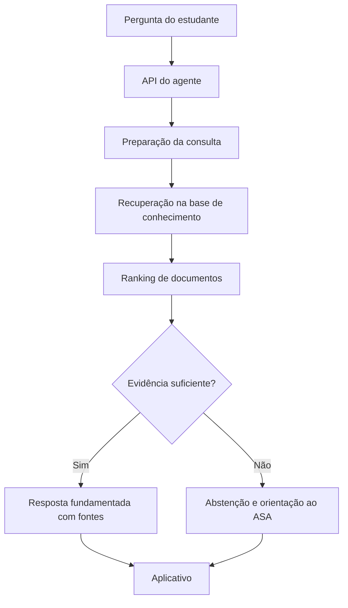

# SecretarIA — Agente para o Estudante

**Projeto Interdisciplinar FECAP | 2026/2**  
**Unidade curricular:** Inteligência Artificial e Aprendizado de Máquina  
**Entrega 2 — Final:** 06/11/2026  
**Apresentação:** Semana FECAP de Tecnologia — 17, 18, 19, 23 e 24/11/2026

## Visão geral

O **SecretarIA — Agente para o Estudante** é uma solução acadêmica voltada à orientação de alunos sobre serviços, procedimentos, documentos, sistemas e canais de atendimento da ASA/FECAP. O objetivo é recuperar informações de uma base de conhecimento e produzir respostas fundamentadas em fontes, com encaminhamento ao atendimento humano quando necessário.

> **Escopo deste README:** requisitos e metodologia da Entrega 2 de Inteligência Artificial e Aprendizado de Máquina. Funcionalidades descritas como previstas devem ser confirmadas no código e na demonstração antes da submissão.

## Objetivos da Entrega 2

- Implementar e avaliar a versão final do agente.
- Comparar modelos ou configurações de recuperação e/ou geração de respostas.
- Validar os resultados com perguntas de teste e referências conhecidas.
- Examinar erros, limitações, viés, explicabilidade e casos de abstenção.
- Versionar código, modelo/configuração e base de conhecimento.
- Integrar um endpoint de inferência ao aplicativo e demonstrar o fluxo completo.

## Fluxo conceitual



## Base de conhecimento e preparação

Os conteúdos de referência devem cobrir, conforme disponibilidade e autorização, os temas:

1. Sistemas e Portal;
2. Documentos e Secretaria;
3. Canais e Setores de Atendimento.

Registrar para cada documento: identificador, título, origem, versão/data de atualização e conteúdo. Na preparação, verificar duplicidades, texto incompleto, atualidade e eventuais dados pessoais. Utilizar apenas materiais autorizados.

## Baseline e comparação de configurações

A **Entrega 1** estabelece uma referência inicial de recuperação de documentos. Na **Entrega 2**, comparar a baseline com pelo menos uma configuração alternativa implementada, por exemplo:

| Configuração | Estratégia | Estado |
|---|---|---|
| Baseline | Recuperação inicial da Entrega 1 | Confirmar implementação |
| Alternativa | Busca vetorial, alteração de Top-K ou limiar de relevância | Confirmar implementação |

Não atribuir melhoria à alternativa antes de medir os resultados em um conjunto de testes comum.

## Avaliação e métricas

Preparar perguntas representativas, com documentos relevantes esperados e critérios de correção. Separar, quando possível, os exemplos usados para ajustar a solução daqueles usados na avaliação final.

| Métrica | Interpretação |
|---|---|
| Precision@K | Fração dos K documentos recuperados que são relevantes |
| Recall@K | Fração dos documentos relevantes que aparece entre os K recuperados |
| MRR | Média do inverso da posição do primeiro documento relevante |
| Hit Rate@K | Fração das perguntas com ao menos um documento relevante no Top-K |
| Groundedness | Grau de sustentação das afirmações pelas fontes recuperadas, segundo rubrica definida |
| Taxa de resposta correta | Respostas corretas divididas pelo total avaliado, segundo critérios documentados |
| Taxa de abstenção | Perguntas não respondidas por falta de evidência suficiente |

### Resultados experimentais

Preencher com os valores **efetivamente obtidos**, identificando dataset, tamanho da amostra, configuração e data da execução.

| Métrica | Baseline | Configuração final |
|---|---|---|
| Precision@K | A preencher | A preencher |
| Recall@K | A preencher | A preencher |
| MRR | A preencher | A preencher |
| Groundedness | A preencher | A preencher |
| Taxa de resposta correta | A preencher | A preencher |
| Taxa de abstenção | A preencher | A preencher |

## Explicabilidade, segurança e limitações

- Exibir as fontes usadas na resposta e, quando disponível, os escores de relevância.
- Definir um critério documentado de **abstenção** para evidência insuficiente, documentos conflitantes ou dúvidas fora do escopo.
- Encaminhar dúvidas que exigem análise individual ao atendimento humano.
- Analisar erros por categoria de pergunta, incluindo linguagem informal, sinônimos e ambiguidades.
- Verificar diferenças de desempenho entre formulações equivalentes de perguntas; não inferir equidade apenas de uma média global.
- Não apresentar orientações não verificadas como regras oficiais da FECAP.
- Evitar exposição de dados pessoais e observar os requisitos de privacidade e LGPD.

## Serviço de inferência

A integração final deve disponibilizar uma interface para o aplicativo enviar perguntas e receber respostas e referências. **O exemplo abaixo é ilustrativo**, não uma declaração de que essa rota já existe no repositório.

```json
{
  "pergunta": "Como solicito meu histórico acadêmico?",
  "resposta": "Consulte o procedimento descrito no documento oficial recuperado.",
  "fontes": ["Guia de Emissão de Histórico Acadêmico"],
  "status": "respondido"
}
```

Documentar no código real a rota, o método HTTP, o esquema de entrada/saída, a autenticação aplicável e os casos de erro.

## Reprodutibilidade e versionamento

Registrar no relatório ou notebook:

- Dependências e versões de bibliotecas;
- Versão da base de conhecimento e origem dos documentos;
- Modelo e parâmetros de recuperação/geração;
- Conjunto de perguntas e gabarito de avaliação;
- Procedimento de execução e resultados obtidos;
- Commit ou tag Git correspondente à versão demonstrada.

## Entregáveis

- [ ] Notebook Python com experimentos e resultados;
- [ ] Código-fonte do agente;
- [ ] Relatório técnico com comparação e análise de erros;
- [ ] Model Card final;
- [ ] Endpoint de inferência integrado ao aplicativo;
- [ ] Demonstração integrada;
- [ ] Banner e pitch de até 4 minutos para a Semana FECAP de Tecnologia.

## Critérios da apresentação

A demonstração deve evidenciar o funcionamento do agente e apresentar resultados verificáveis, considerando **criatividade, impacto social, embasamento dos resultados e respeito ao limite de quatro minutos**.

## Considerações finais

O SecretarIA busca facilitar o acesso dos estudantes às informações acadêmicas. A conclusão da Entrega 2 depende da implementação, avaliação e documentação dos componentes descritos, com resultados reproduzíveis e fontes rastreáveis.

---

**FECAP — Projeto Interdisciplinar, 2026/2**
